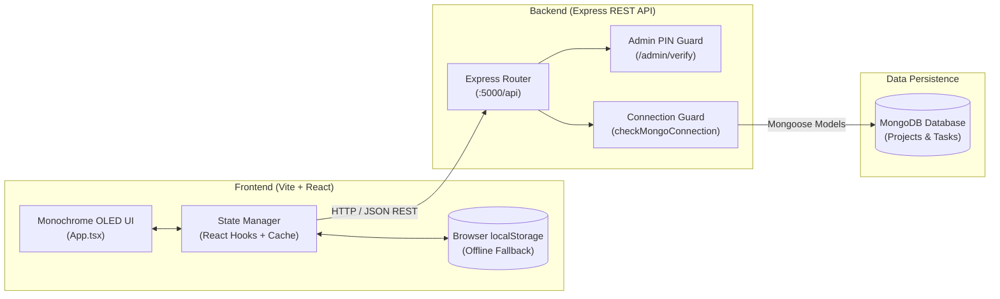

# NexusForge — Project Tracker & LinkedIn Studio

> A high-performance, minimalist full-stack system designed for software engineers to track project milestones, manage development tasks, and instantly generate high-converting LinkedIn posts and resume bullet points with a single click.

---

## 📌 1. Project Overview & Key Features

NexusForge bridges the gap between software development and professional personal branding. Engineered with an **OLED Pure Black minimalist monochrome interface**, it keeps portfolio work distraction-free while offering dual access modes for public showcasing and private management.

### ✨ Key Features

- **Dual-View Task Tracking (Kanban Board & List Mode)**:
  - Organize tasks across `To Do`, `In Progress`, and `Done` states.
  - Interactive status cycling and direct status moves.
  - Categorization (`Frontend`, `Backend`, `Database`, `Security`, `Feature`, `UI/UX`).
  - Real-time search filtering across task titles and impact results.
  - Automatic completion metrics and progress percentage calculations.

- **1-Click LinkedIn Post & Profile Studio**:
  - **Launch Post Generator**: Automatically transforms completed project features into an engaging, high-reach LinkedIn launch post formatted with pain points solved, key highlights, and relevant tech hashtags.
  - **Experience Bullets Mode**: Formats accomplishments into clean, metric-driven bullet points tailored for LinkedIn "Projects" sections or resumes.
  - Live preview and inline markdown/text editing.
  - 1-click copy to clipboard with toast confirmations.

- **Monochrome Admin Dashboard & Public Read-Only Lock**:
  - **Public Read-Only Mode**: Default view for recruiters and LinkedIn visitors where all mutation buttons (`+ Add Project`, `+ Add Task`, `Edit`, `Delete`) are securely hidden.
  - **Admin PIN Authentication**: Unlocks full administrative controls via a secure PIN prompt (default: `1234`).
  - **Portfolio Metrics**: 4 clean stat cards displaying Total Projects, Completed Projects, Total Tasks, and Completed Tasks.
  - **Project Management Table**: Overview of all systems, task completion tallies, and inline edit/delete controls.
  - **Data Resilience Controls**: Export and import complete workspace backups as JSON, or reset to demo data.

- **Hybrid Storage & Offline Resilience**:
  - Automatically syncs with MongoDB via REST API when online.
  - Seamlessly falls back to browser `localStorage` when offline or when the database daemon is disconnected, displaying live status badges (`MongoDB: Connected` / `Storage: Local Mode`).

---

## 🛠️ 2. Tech Stack

| Layer | Technologies |
| :--- | :--- |
| **Frontend** | React 18, TypeScript, Tailwind CSS, Lucide Icons, Vite |
| **Backend API** | Node.js, Express.js (v5), CORS, Dotenv |
| **Database** | MongoDB, Mongoose ORM |
| **Automated Testing** | Vitest 2, React Testing Library, JSDOM, Custom API Test Suite |
| **CI / CD** | GitHub Actions (`.github/workflows/ci-tests.yml`) |

---

## 🏛️ 3. System Architecture Summary



### Architecture Highlights
1. **Frontend**: Single-Page Application (SPA) compiled with Vite, maintaining persistent state in React and caching locally to ensure zero downtime.
2. **REST API Gateway**: Express server exposing clean CRUD endpoints under `/api/projects`, `/api/tasks`, and `/api/admin/verify`.
3. **Resilience Middleware**: Intercepts requests when MongoDB is offline, returning HTTP 503 with graceful flags so the client automatically activates `Storage: Local Mode`.
4. **Relational Deletes**: Deleting a project automatically triggers cascading removal of all associated tasks in MongoDB.

---

## 🚀 4. How to Run Locally

### Prerequisites
- [Node.js](https://nodejs.org) (v18 or v20 recommended)
- [MongoDB](https://www.mongodb.com/) (Local Community Server or MongoDB Atlas cluster URI)
- Git

---

### Step 1: Clone Repository & Configure Environment

```bash
# Clone repository
git clone https://github.com/your-username/nexusforge.git
cd nexusforge

# Setup Frontend environment variables
cp .env.example .env

# Setup Backend environment variables
cp server/.env.example server/.env
```

> **Note**: In `server/.env`, verify your connection string (default is `mongodb://127.0.0.1:27017/nexusforge`).

---

### Step 2: Install Dependencies

```bash
# 1. Install frontend dependencies (root)
npm install

# 2. Install backend dependencies (server)
cd server
npm install
cd ..
```

---

### Step 3: Run the Application

Open two terminal windows:

#### Terminal 1 — Start Backend Server (Port 5000)
```bash
cd server
npm run dev
```
*Backend runs at `http://localhost:5000` (Health check: `http://localhost:5000/api/health`)*

#### Terminal 2 — Start Frontend Application (Port 5173)
```bash
npm run dev
```
*Frontend runs at `http://localhost:5173`*

---

## 🧪 5. Automated Testing Suite

NexusForge features an extensive **40-test automated suite** covering the frontend UI, user flows, REST endpoints, and database schemas:

```bash
# Run 22 Frontend UI & Component Tests (Vitest + JSDOM)
npm test

# Run 18 Backend API, Auth & Model Tests
npm run test:server

# Run the complete 40-test pipeline across both frontend and backend
npm run test:all

# Run production build check (TypeScript & Vite)
npm run build
```

---

## 🔐 6. REST API Reference

| Method | Endpoint | Description |
| :--- | :--- | :--- |
| `GET` | `/api/health` | Server status and MongoDB connection flag |
| `POST` | `/api/admin/verify` | Validates admin PIN (`{ pin: "1234" }`) |
| `GET` | `/api/projects` | Fetch all projects (auto-seeds defaults if empty) |
| `POST` | `/api/projects` | Create a new project |
| `PUT` | `/api/projects/:id` | Update project details |
| `DELETE` | `/api/projects/:id` | Delete project and cascade-delete child tasks |
| `GET` | `/api/tasks` | Fetch tasks (supports optional `?projectId=...`) |
| `POST` | `/api/tasks` | Create a new task |
| `PUT` | `/api/tasks/:id` | Update task title, status, result, or category |
| `DELETE` | `/api/tasks/:id` | Delete task by ID |

---

## 📄 License

This project is licensed under the MIT License.
